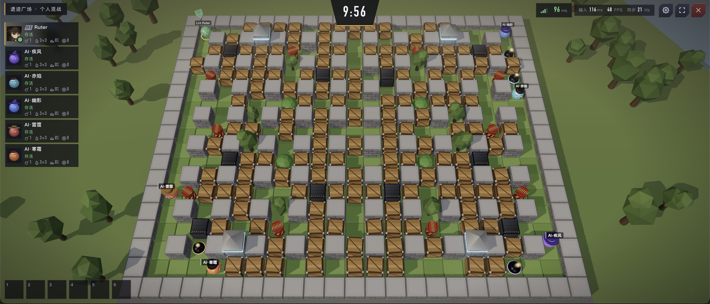
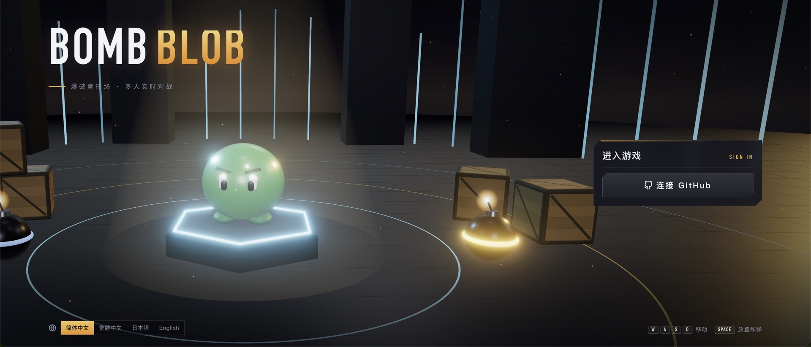
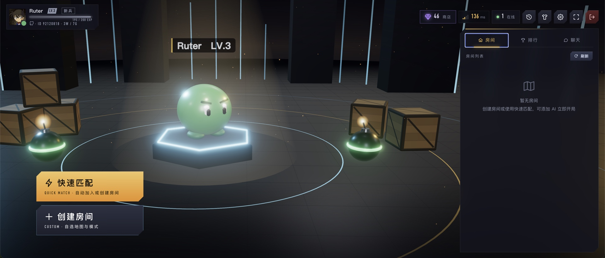
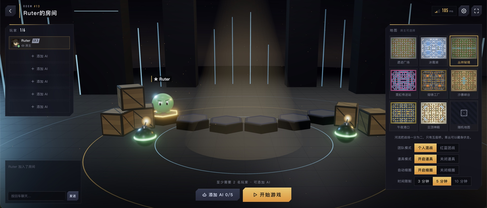
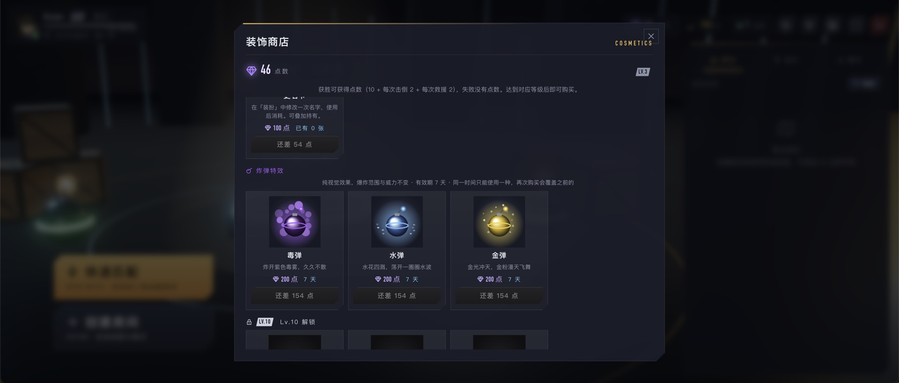

# BombBlob 泡泡爆爆

脑子热用Claude做的多人在线果冻炸弹对战游戏（泡泡炸弹类玩法）。最多 6 人同场，个人混战或红蓝团战，14 张主题地图。

- **前端**：three.js 3D 渲染 + 原生 HTML/CSS/JS（无需构建），简体中文 / 繁體中文（香港）/ 日本語 / English
- **后端**：Python（aiohttp + WebSocket），服务器权威：炸弹、爆炸、伤害、道具、胜负全部由服务器判定；移动由客户端计算、服务器校验
- **数据库**：PostgreSQL（asyncpg）：账号、一次性登录 token、经验 / 等级、点数、装饰、对局与对战记录
- **安全**：登录与游戏通信在 HTTPS 之外再做一层 RSA + AES-128-GCM 加密

📦 **部署到服务器请看 [DEPLOY.md](DEPLOY.md)**（Docker、环境变量、密钥、GitHub OAuth、HTTPS 反向代理、备份与升级、排障）。

## 游戏截图



| 登录 | 大厅 |
| --- | --- |
|  |  |
| **房间** | **商店** |
|  |  |

## 快速开始（本地开发）

```bash
scripts/db.sh start                                   # 本地 PostgreSQL（.pgdata/，端口 5433，含测试库）
python3 -m venv .venv && .venv/bin/pip install -r requirements.txt
cp .env.example .env                                  # 按需修改（默认开启游客登录）
.venv/bin/python -m backend.server                    # 打开 .env 里 PUBLIC_URL 对应的地址
```

- `.env` 已在 `.gitignore` 中，不会提交；`.env.example` 自带一把**公开的默认 RSA 私钥**，仅供本地运行，部署前请按 [DEPLOY.md](DEPLOY.md#3-生成传输加密密钥必做) 生成自己的密钥。
- 本地用 `http://127.0.0.1` 或 `http://localhost` 访问即可；其他地址必须用 HTTPS（浏览器只在安全上下文提供加密功能）。
- 运行测试：`.venv/bin/python -m unittest discover tests`（使用 `bombblob_test` 数据库）

## 账号与登录

- 登录页只有两个入口：**连接 GitHub**（`LOGIN_GITHUB=true`）和 **游客登录**（`LOGIN_GUEST=true`）。
- **GitHub 登录**：OAuth 授权码模式，不申请任何权限，只取 GitHub 用户 ID（绑定账号）和头像（显示给其他玩家）；不保存 GitHub 用户名。state + Cookie 防 CSRF，回调后用 60 秒有效的一次性交换码换取凭证。
- **游客登录**：自动创建账号并弹出 **8 位数字 ID**（新 ID 不含数字 4）；游客模式开启时，也可以在游客按钮下方用 8 位 ID 登录。
- **登录页**：进入时请求 `/api/login-info`。`LOGIN_GITHUB` 开启时显示「GitHub 登录」；`LOGIN_GUEST` 开启时显示「8 位 ID 输入框 + 游客登录」；两个都开启时都显示；两个都关闭时服务器无法启动。关闭的那种登录方式，其接口直接 404。
- **不自动登录**：每次都要手动点登录，GitHub 每次都要授权一次。localStorage 不保存任何登录凭证，只保存语言、音量和上次的 8 位游客 ID（打开页面时填回输入框）。`/api/guest` 里原来的 token 自动登录代码已注释停用。
- **创建角色**：新账号登录后先进入「创建角色」（名字、颜色、头饰），完成后才进入大厅。
- **名字规则**：先 trim，长度 1–8 个字；只允许文字、字母、数字和空格；屏蔽不雅词（中 / 繁 / 粤 / 日 / 英）和冒充系统的词（如「断开连接」「系统」「Admin」），比对时会去掉空格符号、统一全角与大小写，防止拆字绕过。之后改名需要商店的**改名卡**。

## 传输加密

1. 网页写死 RSA-2048 公钥（`public/js/rsa-public.js`，一行，方便替换），服务器持有私钥（`RSA_PRIVATE_KEY`）。
2. 登录请求：网页生成一次性 AES-128 密钥，用 RSA-OAEP(SHA-256) 加密后连同 AES-128-GCM 加密的请求体发送；响应也用它加密，并带回本次会话的 **AES-128 会话密钥**（唯一 token，从不以明文出现）。
3. 游戏 WebSocket（`/api/gamesocket`）全部是 AES-128-GCM 二进制帧，IV = 方向 ‖ 连接号 ‖ 帧序号：截获的帧无法重放、调换顺序或用在别的连接上，校验失败立即断开（关闭码 4002）。
4. 未加密的登录请求返回 `400 {"code":"bad_request"}`，明文 WebSocket 帧被忽略；排行榜、对战记录等数据只走加密通道。
5. 换密钥：`python scripts/gen_rsa.py`（写入 `rsa-public.js` 与 `.env`）或 `--print`（只打印单行私钥，用于 `docker run -e`）。服务器启动时检查公私钥是否配对。

实现：`backend/secure.py`、`public/js/secure.js`。100 人压测时加密开销约为 CPU +9%，延迟不变。

## 客户端上报数据的规则

- **定向取值**（`backend/textrule.py`）：每种消息都按字段名逐个 `msg.get("x")` 读取并校验类型，没有约定的字段一律不看，不认识的消息类型整条丢弃。登录接口（`/api/guest`、`/api/login`、`/api/oauth/exchange`）同样如此。
- **全局文本规则**：所有字符串先做 NFKC（全角转半角），再去掉全部空白，只能剩中文（汉字）、英文字母和数字。含其他任何字符（标点、符号、表情、假名、韩文……）整条拒绝，返回错误码 `text_invalid`。唯一例外是**聊天消息**：不限制字符（标点、符号、表情、各国文字都可以），服务器只去掉不可见的控制 / 双向文本字符、合并多余空白、最多 120 字；前端一律当纯文本显示（转义或 `textContent`），绝不会被执行。
  - 因为 `-` 不允许，语言代码 `zh-HK` 上报时写成 `zhHK`。
  - 机器人 ID 改为 `bot1x2` 这种只有字母数字的形式。
- **禁止注入**：代码中没有任何 `eval` / `exec` / `new Function`；SQL 全部使用参数化查询；页面上的玩家文字一律转义或用 `textContent` 显示；头像只接受 GitHub 官方头像域名。

## 断线重连

- 4 秒收不到任何消息即判定掉线，显示「正在重连」并冻结本地操作；重连后按服务器的当前状态完整重建对局。
- 对局中关闭浏览器，再次打开并登录后会自动回到原来的对局。
- 对局中有人断线 / 重连，全场屏幕上方显示几秒：头像 + 名字，下一行「断开连接 / 重新连接」。
- 房间里（未开局）断线超过 10 秒自动离开房间；服务器每 4 秒心跳。

## 数据库

初始化脚本：[`db/init.sql`](db/init.sql)（表、索引、约束与 1–50 级等级数据）。服务器启动时会在咨询锁保护的事务中自动执行它，也可以手动执行：

```bash
psql "$DATABASE_URL" -f db/init.sql   # 可重复执行，不会覆盖线上调整过的等级数据
```

| 表 | 用途 |
| --- | --- |
| `users` | 账号（游客 / GitHub ID + 头像）、角色（名字 / 外观 / 是否已创建）、语言、经验、等级、点数、改名卡、战绩 |
| `login_tokens` | 一次性登录 token（只存 SHA-256） |
| `levels` | 等级表：每级所需累计经验、段位、解锁头饰（调平衡直接改表） |
| `matches` | 对局记录（`match_key` 保证重试不会重复结算；对战记录数据来源） |
| `match_players` | 每局每位真人玩家的名次、击倒、救援、获得经验 / 点数、结算后等级 |
| `cosmetics` | 商店装饰目录：解锁等级、价格 |
| `user_items` | 玩家已购买的装饰（主键 user_id + item_id） |
| `name_changes` | 改名记录（旧名 / 新名 / 时间） |
| `meta` | 内部元数据（等级表校验值） |

**所有字段都是 NOT NULL，数据库里不存 NULL**：没有值时文本存 `''`，数字存 `0`，时间存 `'epoch'`（1970-01-01，表示「尚未发生」，例如 token 未使用）。唯一例外是 `matches.winner_team`：没有获胜队伍时存 `-1`，因为 `0` 是红队。对局结果 JSON（`matches.result`）写入前也会把 null 换掉。旧库里可为空的列，启动时会自动迁移（一次性）。

每个查询都有对应索引（20 万用户 / 60 万 token / 40 万对局记录实测）：

| 查询 | 索引 | 实测 |
| --- | --- | --- |
| 排行榜 Top 20 | `users_leaderboard`（与排序完全一致的部分覆盖索引，仅索引扫描） | 0.01 ms |
| 消费一次性 token | `login_tokens_pkey` | 0.1 ms |
| GitHub 账号查找 | `users_github_id`（部分唯一索引） | 0.01 ms |
| 对战记录 | `match_players_user_recent (user_id, match_id DESC)` | 0.01 ms |
| 结算时经验 → 等级（SQL 内原子计算） | `levels_exp` | 0.06 ms |
| 清理过期 token | `login_tokens_used` / `login_tokens_unused`（部分索引，分批删除） | 每批约 3 ms |

可靠性：结算在单个事务内完成并带幂等键；连接 / 死锁 / 超时类错误自动重试（指数退避）；关服时等待所有写入完成；CHECK 约束保证数据合法；语句超时 10 秒。

## 多语言

- 支持 **简体中文、繁體中文（香港）、日本語、English**。
- 默认语言取浏览器首选语言（`navigator.languages[0]`）：含 `HK` → 繁體中文；`zh` 开头 → 简体中文；`ja` 开头 → 日本語；其他 → English。
- 登录页左下角和游戏内「设置」可以切换语言；登录后切换会写入该账号的记录（`users.lang`），换设备登录时自动使用账号保存的语言。
- 服务器不返回提示文字：REST 错误只返回 `{"code": "..."}`，WebSocket 返回错误码 / 事件 key + 参数，所有文字在 `public/js/i18n.js` 中翻译。

## 房间

- 可以创建房间，或在大厅列表中选择房间加入（也支持快速匹配）。
- 建房时可设置 **6 位数字 / 英文的房间密码**：列表中显示锁标志，加入需输入密码；房间成员能看到密码；快速匹配不会进入有密码的房间。
- 每个房间**最多 6 人**；房主可以添加机器人，**最多 6 − 真人数** 个。
- 机器人有三个难度，添加时选择，房主在房间里也可以随时点击修改（`backend/bot.py`）：
  | 难度 | 行为 | 形象（随机头饰） |
  | --- | --- | --- |
  | 简单 | 以自保为主；几乎不吃道具（只吃身边 2 格内的），很少主动炸人，不戳破敌人的泡泡；反应慢，被别人的炸弹威胁时有 20% 概率犯傻不躲 | Lv0–19 可用的头饰 |
  | 中等 | 看到道具就去吃（连减速鞋也吃）；别人的炸弹快炸了才发现；只打附近的敌人，会戳破附近被困的敌人 | Lv20–39 |
  | 难 | **速度 +3%**（AI 专属）；按每个格子着火 / 熄火的时间规划躲避（会利用时间差，按 46% 命中规则计算），走到一半也会掉头；避开能被一颗炸弹封死的位置；敌人逃不掉时放封路炸弹；救人 / 戳泡泡优先 | Lv40 以上 |
  - 缩圈开始后，所有机器人会提前往最后才落墙的方向移动；寻路会考虑传送门。
  - 实测（1 对 1、各 40 局）：中等对简单 35 胜 5 负，难对中等 22 胜 4 负 14 平，难对简单 38 胜 1 负；6 个「难」同场每帧平均 0.14 ms、最慢 4.5 ms。
- 房主选择地图：**14 张地图 + 随机地图**；模式：个人混战 / 红蓝团战；缩圈可开关。
- 房间聊天、大厅聊天、房主可以移除玩家或机器人。
- **对战记录**（大厅右上角）：最近 30 局的胜负 / 名次、同局玩家（头像、队伍）、击倒 / 救援、获得的经验与点数。

## 地图（23 × 19）

每张地图只设计左上象限，再镜像成完整地图，保证出生点完全对称公平。每张地图都有自己的地形结构（大道、冰湖、河流沙洲、电路走线、回字形环墙、集装箱堆场、八角看台……），不使用千篇一律的「隔一格一根柱子」阵列。

| 地图 | 特色 |
| --- | --- |
| 遗迹广场 | 十字林荫大道通向中央广场，四个街区是坍塌的古城残垣 |
| 冰霜湖 | 每个象限一座圆形冰湖，松林环绕，冰面加速 |
| 丛林秘境 | 蜿蜒的河流夹着一条沙洲，只有几处浅滩；草丛可以藏身，炸弹能烧掉草丛 |
| 霓虹传送站 | 电路板式的 L 形能量墙通道，四座传送门连通对角 |
| 熔铸工厂 | 传送带从四角送向中央熔炉，冲压机与油桶守在两旁 |
| 沙暴峡谷 | 斜向岩脊切出一道道峡谷，中央棕榈绿洲，油桶埋伏 |
| 午夜港口 | 2×2 钢箱垛组成的集装箱堆场与龙门吊，运河只留几座栈桥，传送带送向中央 |
| 云顶神殿 | 两层回字形环墙围住中央圣坛，每层只留几道门；两组传送门与冰面回廊 |
| 樱花庭院 | **草丛再生**：被烧掉的草丛 15 秒后重新长出来，锦鲤池点缀，最适合埋伏 |
| 雷鸣矿坑 | **金色宝箱**：炸开必出道具；油桶密布，一颗炸弹引发连环爆破 |
| 极光冰川 | **冰墙闸门**：两组冰墙每 7 秒轮流升降（升起前 1.5 秒预警，格子里有人 / 炸弹时不会升起），迷宫不断变化 |
| 星际空港 | **补给台**：每 12 秒空投一次道具；十二座传送门组成迷阵 |
| 烈日斗兽场 | **火焰喷口**：每 9 秒向四周喷火（威力 2，预警 1.6 秒）；中央是空旷的竞技场 |
| 火山孤岛 | **火山陨石**：每 6.5 秒落下 3 颗陨石（其中一颗砸向某位玩家附近，预警 1.6 秒）；熔岩分出四座孤岛，八座窄桥相连 |

建筑类型：石墙 / 树木 / 塔楼（不可破坏）、木箱（一次摧毁）、**钢制货箱**（需两次爆炸）、**爆炸油桶**（被引爆后二次爆炸，威力 2）、草丛、水 / 熔岩、冰面、传送带、传送门、金色宝箱、冰墙闸门、补给台、火焰喷口。机关爆炸不属于任何玩家；AI 会把已预警的机关火焰当作即将爆炸的炸弹来躲。

## 规则与道具

- 移动：`WASD` / 方向键，自由移动（松手即停，可以停在两格之间）；拐角处偏离通道不超过 0.6 格时自动滑入通道。
- 放炸弹：`空格` / `J`，炸弹放在角色中心所在的格子里。
- 炸弹 2.5 秒后爆炸，十字形火焰；可摧毁木箱、引爆其他炸弹和油桶。
- **被火焰击中会被困住 10 秒**：只能缓慢移动、不能放炸弹。
  - 只有**未被困**的玩家才能救人或击破：自由的队友碰到 → 救出并复活；自由的敌人碰到（不论谁主动碰谁）→ 直接击破；
  - 双方都被困住时互相碰到，什么都不会发生（被困的队友之间也不能互救）；
  - 10 秒内无人救援 → 淘汰。
- **开局和每次被救活后都有 3 秒无敌**。
- 命中判定按角色身体实际覆盖的区域计算（覆盖某格 ≥ 46% 才会被该格火焰命中），接触按角色间距离判定。
- 传送门四周不会生成木箱，传送过去后一定能走开。
- **道具**（房间可关闭）：左下角道具栏 6 格。捡到的道具放进第一个空格，6 格满了就捡不起来（道具留在地上）。按数字键 **1–6** 使用（手机上点格子），用掉后那格变空，下次捡到的道具会填进去。地上的道具是圆形徽章，普通加成是六边形。
  | 道具 | 效果 |
  | --- | --- |
  | 针 | 只能在被困时用：立即戳破泡泡脱困 |
  | 无敌盾牌 | 3 秒内被炸到什么都不会发生（金色光罩）；被困时不能用。与「护盾」不同：护盾捡到就生效并一直有效，直到挡下一次 |
  | 超级跑鞋 | 5 秒内速度直接提升到 +50% |
  | 透明人 | 隐身 10 秒：敌人只看到地上淡淡的水波纹，自己和队友看到半透明 |
  | 腾飞之翼 | 5 秒内可以越过炸弹（无视炸弹阻挡），被火焰炸到照样被困 |
  - 被困时只能用针，其他道具都不能用。
  - AI：简单不会专门去捡道具，路过碰到会捡起来，但从不使用；中等在道具掉出来时，离它最近的那个 AI 掷骰子，50% 去捡，会用道具但不会用针（捡到后过几秒随手用掉，没路可逃时开无敌盾牌）；难全都捡，并挑时机用：被困时用针，躲不掉时依次试腾飞之翼 → 超级跑鞋 → 无敌盾牌，追击时开透明人 / 超级跑鞋。
  - 透明人对简单、中等 AI 完全隐形；难每 3 秒掷一次骰子，30% 能「看见」你，这 3 秒内透明对它无效。
- **房间玩法设置**：团队模式（个人混战 / 红蓝团战）、道具模式（开启 / 关闭道具）、自动缩圈（开启 / 关闭）、时间限制（3 / 5 / 10 分钟）。
- 一局 10 分钟；缩圈可在建房 / 房间设置中开关（默认开）：开启时最后 60 秒墙壁从外向内落下，被砸中直接淘汰。
- 游戏左侧玩家卡显示 GitHub 头像（游客显示角色形象）。
- 自己头顶有箭头标识（个人战为角色颜色，团队战为所在队伍的红 / 蓝）；团队战中其他玩家名字前有红 / 蓝圆点。
- 最后存活的玩家（或队伍）获胜；时间到时比较未被困的人数，相同则平局。

| 道具 | 效果 |
| --- | --- |
| 炸弹 | 可连放数量 +1（起始 1，最多 8） |
| 火焰 | 爆炸威力 +1（起始 3×3，最大 13×13） |
| 威力 +50% | 当前威力提升 50%（向上取整：3×3 → 5×5 → 7×7 → 11×11 → 13×13） |
| 红色跑鞋 | 速度 +5%（最多 +35%） |
| 绿色跑鞋 | 速度 −5%（最多 −25%） |
| 护盾 | 免疫一次伤害 |
| 踢弹 | 走向炸弹时把它踢出去 |

淘汰时会掉落部分已收集的道具。

## 网络与延迟

- 服务器以 **60Hz** 模拟（判定精度），以 **30Hz** 广播状态（同步频率，可用环境变量 `SYNC_HZ` 调整，10–60）；地图只在变化时下发（重连时附带完整地图）。
- **移动在客户端**：自己的角色由客户端计算移动（`public/js/predict.js`），约 30Hz 上报位置 `{t:"mv", x, y, e}`。
- **服务器校验移动**（`Game.client_move`）：
  - 速度：按角色当前速度累积移动额度（容差 15%，最多累积 1 秒以吸收网络抖动），超出即拒绝；
  - 路径：沿轴向路径逐段检测，不能穿过墙、箱子或炸弹（起点已覆盖的格子除外，所以能走出自己脚下的炸弹）；传送只允许从传送门中心跳到配对的出口；
  - 不合理的上报直接拒绝：服务器位置不变、`fx` 计数 +1，客户端看到后回到服务器位置；回滚前仍在网络中飞行的旧上报（`e` ≠ `fx`）直接丢弃，避免连锁回滚。
- **放炸弹**：按下时客户端立即显示炸弹，并把放置位置一起上报；炸弹是否成立、爆炸与伤害判定全部在服务器。
- **延迟补偿**：服务器看到的位置比玩家屏幕上晚约一个单程延迟，所以火焰命中客户端移动的玩家时，会等待 `min(单程延迟 + 33ms, 150ms)`；若这段时间内的上报显示已离开火焰，则算躲开。
- 实测：模拟 150ms 往返延迟 + 抖动，连续随机移动和放炸弹 40 次，被服务器拒绝 0 次。
- 异常观察（`backend/anticheat.py`）：被拒绝的移动、超过每秒 10 次的放炸弹请求（突发 4 次）都记为异常。每个玩家在 map 里存「次数 + 到期时间」，不用定时器：到期或没有时间就从 1 开始计并把到期时间设为 10 秒后，否则 +1；10 秒内累计 3 次就提醒玩家（4 国语言提示），并在服务器日志记录 `[anticheat]`。
- **服务器时间戳插值**：其他玩家按服务器时间戳插值显示，消除网络抖动。
- 客户端渲染锁定 60fps；WebSocket 关闭压缩以减少处理延迟。
- 右上角显示与服务器的往返延迟（信号格），HUD 同时显示输入确认延迟、FPS、同步频率。
- 设置里可选**多重采样**（无 / 2× / 4× / 8×，默认 4×，保存在本地浏览器），立即生效。

### 压力测试

```bash
.venv/bin/python scripts/loadtest.py --players 100 --seconds 40 --pid $(pgrep -f backend.server)
```

本机实测（单进程，Apple Silicon）：

| 同时在线 | 房间 | 服务器 CPU | 内存 | 快照间隔 p99 | 输入→确认 p50 / p99 | 服务器出口 |
| --- | --- | --- | --- | --- | --- | --- |
| 100 | 17 | 平均 10%（峰值 19%） | 58 MB | 53.6 ms | 27.5 / 52.1 ms | ≈ 1 MB/s |
| 300 | 50 | 平均 17%（峰值 23%） | 65 MB | 51.4 ms | 25.8 / 50.2 ms | ≈ 4 MB/s |

## 奖励、等级与装饰商店

每局结算写入数据库（`matches` / `match_players` / `users`，一个事务内完成）：

| | 经验 | 点数（买装饰） |
|---|---|---|
| 胜利 | 100 + 10 × 击倒 + 10 × 救援 | 10 + 4 × 击倒 + 2 × 救援 |
| 失败 | 胜利同等表现的 15%（最少 5） | 胜利同等表现的 15%–35%（随机浮动） |
| 主动退出 | 0（无论本局最终结果，所在队伍获胜也一样） | 0 |

**点数加成**（百分比直接相加，不相乘；游戏中不显示，结算时显示明细）：
- **连杀**（仅获胜）：没有被泡泡包住的情况下连续击倒，每连杀 1 人 +5%，最多 +30%；被泡泡包住就清零，按结束时的连杀数计算。
- **复活赛排名**：前三名 +25% / +15% / +5%（得分需 > 0）。
- **点数卡**：×1.5 / ×2 / ×3 即 +50% / +100% / +200%。例：连杀 +30% 加双倍点数卡 → 100% + 30% + 100% = **230%**（不是 260%）。

**复活赛**（房间选项，开启后不缩圈）：被淘汰后身上所有能力道具与道具栏道具全部掉落（服务器随机撒在全图空地上），能力回到初始值；3 秒后在全图随机空地复活，复活后无敌 3 秒。时间到后结算：个人赛按击倒数排名（同分看阵亡次数），团队赛按「击倒 + 0.5 × 救援」累计队伍得分，高者获胜；个人按同一得分排前三名拿排名加成。普通模式下阵亡时，道具栏里没用掉的道具也会随机掉在全图。

旧版本的「金币」已并入点数：升级时 `db/init.sql` 按 5:1 自动折算（旧金币 50 + 10×击倒 ≈ 5 倍点数），随后删除金币列。

- **等级无上限**：Lv.N → N+1 需要 `100 + 50 × (N − 1)` 经验。`levels` 表存 1–50 级，之后由数据库函数 `bb_level()` 按同一曲线继续计算（Lv.10 累计 2,700；Lv.50 累计 63,700；Lv.60 累计 91,450）。
- 段位：新兵 Lv.1 · 青铜 Lv.5 · 白银 Lv.10 · 黄金 Lv.15 · 铂金 Lv.20 · 钻石 Lv.30 · 大师 Lv.40
- 基础头饰按等级免费解锁：战术头带 Lv.2 · 耳机 Lv.3 · 犄角 Lv.5 · 鸭舌帽 Lv.8 · 王冠 Lv.12
- **装饰商店**（大厅右上角的点数按钮）：达到等级后用点数购买，买完自动装备：

| 等级 | 装饰 | 价格 |
|---|---|---|
| Lv.10 | 贝雷帽 · 护目镜 · 头巾 | 各 150 点 |
| Lv.20 | 牛仔帽 · 骑士盔 · 光环 | 各 300 点 |
| Lv.30 | 礼帽 · 巫师帽 | 各 500 点 |
| Lv.40 | 冰晶冠 · 烈焰冠 | 各 800 点 |
| Lv.50 | 龙角 · 星环 | 各 1,200 点 |

  定价依据：平均每胜约 14 点、约 130 经验。到 Lv.10 约 20 胜、累计约 280 点，刚好能买 1 件；到 Lv.50 约 490 胜、累计约 6,900 点，全部 12 件共 6,350 点，可以全部收齐，但要有取舍。
- 购买在一个事务里完成：`INSERT user_items … ON CONFLICT DO NOTHING`（主键防重复购买）+ `UPDATE users SET points = points − 价格 WHERE points >= 价格 AND bb_level(exp) >= 等级`，任何一步失败整体回滚；并发购买不会超扣点数。
- **更名卡**：商店「道具」栏，100 点一张，可叠加。改名只能在「装扮」窗口里使用更名卡，每次消耗 1 张；没有更名卡无法改名（装扮保存、重新登录都不会改名字）。扣卡与改名在同一条 `UPDATE … WHERE rename_cards > 0` 中完成，改名历史写入 `name_changes` 表。
- **功能性道具配置**：更名卡、炸弹特效、加成卡的价格与时长都在 `db/store_item.json`，按商品 ID 逐项配置（`rename` / `poison` `water` `gold` / `exp150` `exp200` `exp300` `pts150` `pts200` `pts300`），修改后重启服务器生效。`price` 为 `-1` 表示物品不可用；缺少某个 ID、格式不对、或内容与 ID 对不上（例如 `exp150` 的 `kind` / `pct` 不是 `exp` / `150`）也会让该物品不可用——商店显示「物品不可用」且服务器拒绝购买，其他物品不受影响，原因打印在服务器日志里。
- **加成卡**：商店「加成卡」栏，购买后 **24 小时**内对局获得的经验 / 点数按倍率加成，到期自动失效：

  | 卡 | ×1.5 | ×2 | ×3 |
  |---|---|---|---|
  | 经验卡 | 160 点 | 220 点 | 300 点 |
  | 点数卡 | 200 点 | 280 点 | 360 点 |

  经验卡和点数卡各占一个位置，可同时生效。再买同一倍率：在当前到期时间上再加 24 小时；买更高倍率：立即替换，从现在起 24 小时；同类卡有更高倍率生效中时不能买低倍率（商店显示「已有更高倍率」，服务器同样拒绝）。按结算时刻是否在有效期内计算（向下取整），结算界面显示 ×倍率标记。数据存在 `users.exp_boost(_until)` / `users.points_boost(_until)`（倍率按百分比存），购买记录写入 `boost_purchases` 表；扣点数与改有效期在同一条 `UPDATE … WHERE points >= 价格` 中完成。
- **炸弹特效**：商店「炸弹特效」栏，**纯画面**，爆炸范围、威力、时间与普通炸弹完全一样。毒弹会炸出紫色毒雾，久久不散；水弹会荡开水波、溅起水花；金弹有金色光柱和金粉。**每次 200 点，有效 7 天**。同一时间只有一种生效：再次购买（同一种或另一种）都会覆盖之前的，有效期从购买时重新算 7 天，剩余时间不叠加。过期后自动恢复普通火焰。数据存在 `users.bomb_style` / `users.bomb_until`，购买记录写入 `bomb_purchases` 表。对局开始时按当时是否在有效期内决定用哪种特效。
- 商品目录在 `cosmetics` 表，改价格 / 等级直接改表后重启即可；客户端从服务器获取目录。
- 游戏内每吃到一个道具，左上角会显示道具说明卡和当前数值（最多 3 张），5 秒后自动消失

## 画面

整体为成熟的竞技游戏风格：
- **菜单场景**：暗色"角色展示台"——反光地面、六边形发光台座、聚光灯光柱、背景灯条与浮尘；房间内 6 个台座排成阵容，灯带颜色表示准备状态 / 队伍。
- **渲染**：PBR 材质 + 环境反射（RoomEnvironment）、圆角倒角方块、砖石 / 木板 / 金属纹理、低角度主光与长阴影、辉光后处理（按主题调节阈值）、暗角。
- **地图氛围**：遗迹广场（黄昏）、冰霜湖（雪原）、丛林秘境（萤火）、霓虹传送站（网格与水晶）、熔铸工厂（工业、熔岩、警示条纹）、樱花庭院（樱花树）、雷鸣矿坑（矿洞余烬）、极光冰川（极光夜色）、星际空港（星空网格）、烈日斗兽场（烈日黄沙）、火山孤岛（熔岩海）。
- **UI**：深色半透明切角面板、窄体字标与数字、琥珀 / 青色点缀光、统一线性矢量图标（无 emoji）、斜切转场、游戏内确认框（无浏览器原生弹窗）。
- **战斗演出**：开场镜头俯冲、倒计时、击倒播报、拾取提示、受伤红闪、区域收缩警报、VICTORY / DEFEAT 结算。

## 音乐

全部是 Web Audio 实时合成的原创音乐，没有任何音频文件（不占带宽、即时加载）。每张地图 + 大厅各一首，由和弦进行和固定种子生成旋律，并按地图风格与玩法单独配器：

| 地图 | 曲名 | 速度 | 音阶 | 配器 |
|---|---|---|---|---|
| 遗迹广场 | Ruins Run | 118 | 多利亚 | 铜管主奏、行走低音、进行曲军鼓 |
| 冰霜湖 | Cold Front | 100 | 小调 | FM 钟琴、持续低音、快速琶音、风声 |
| 丛林秘境 | Undergrowth | 112 | 小调五声 | 马林巴拨弦、八度低音、部落鼓 + 沙锤、虫鸣，摇摆节奏 |
| 霓虹传送站 | Gridline | 128 | 小调 | 扫频合成、八分脉冲低音、四拍舞曲、提示音 |
| 熔铸工厂 | Molten Core | 132 | 弗里几亚 | 失真主奏、16 分脉冲低音、工业金属打击、机器滴答 |
| 沙暴峡谷 | Dust Devil | 104 | 阿拉伯风 | 长笛（颤音 + 气声）、持续低音、手鼓、圣咏铺底、风沙 |
| 午夜港口 | Night Shift | 92 | 多利亚 | 玻璃电钢、行走低音、刷鼓、水声，爵士摇摆 |
| 云顶神殿 | Skyward | 108 | 利底亚 | 钟琴、圣咏铺底、上下琶音、星光闪烁 |
| 樱花庭院 | Petal Drift | 96 | 平调子 | 古筝、太鼓、长回声 |
| 雷鸣矿坑 | Fuse Line | 142 | 小调 | 芯片方波、碎拍、导火索噼啪 |
| 极光冰川 | Aurora | 84 | 利底亚 | 玻璃音色、长铺底、无鼓、风声 + 闪烁 |
| 星际空港 | Orbit | 124 | 多利亚 | 扫频合成、16 分脉冲、雷达提示音 |
| 烈日斗兽场 | Gladius | 120 | 和声小调 | 铜管号角、太鼓、观众欢呼 |
| 火山孤岛 | Eruption | 146 | 阿拉伯风 | 失真主奏、工业鼓、熔岩噼啪 |

**炸弹音效**按炸弹特效区分：普通（沉闷的「咚」/ 低沉爆炸）、毒弹（冒泡放置 / 毒气喷涌 + 咕嘟声）、水弹（水滴「咕咚」/ 「哗啦」水花 + 下坠低音）、金弹（金币叮声 / 爆炸后一串金色钟声）。其他玩家放炸弹、爆炸时听到的也是他们自己炸弹的声音。

## 目录结构

```
backend/
  server.py   HTTP 入口、加密登录接口、/api/gamesocket
  lobby.py    大厅、房间（密码 / 断线宽限）、聊天、商店 / 改名 / 对战记录等消息路由
  game.py     服务器权威的游戏模拟（60Hz，默认 30Hz 广播）、客户端移动校验
  bot.py      机器人 AI（与真人使用同一套输入接口）
  maps.py     14 张地图定义（四分之一镜像）与地图机关
  store.py    PostgreSQL：账号、一次性 token、会话、奖励、等级、商店、对战记录
  secure.py   传输加密（RSA-OAEP + AES-128-GCM）
  names.py    名字校验（长度 / 字符 / 屏蔽词）
  oauth.py    GitHub OAuth
  config.py   环境变量
  i18n.py     服务器端少量多语言文本（默认名字 / 房间名）
db/init.sql   数据库结构、索引、约束、等级与商品初始数据（启动时自动执行）
public/
  index.html, css/style.css
  js/main.js     界面与流程          js/scene.js    three.js 游戏渲染
  js/stage.js    菜单 3D 展示台      js/predict.js  客户端移动（自由移动 + 滑角）
  js/net.js      登录、WebSocket、重连 js/secure.js   传输加密
  js/i18n.js     四种语言            js/levels.js   等级 / 段位 / 商店目录
  js/themes.js   配色、角色、头饰、地图预览   js/audio.js  程序化音乐与音效
  js/rsa-public.js  写死的 RSA 公钥
  vendor/        three.js
scripts/
  db.sh          本地 PostgreSQL 管理
  gen_rsa.py     生成 RSA 密钥对
  loadtest.py    压力测试
DEPLOY.md        部署手册
demoImage/       README 里的游戏截图（1920 宽）
tests/           规则单元测试 + 端到端服务器测试（124 个）
```
